# State Estimation Toolbox

Just a fairly simple state estimation and parameter inference toolbox. Fourteen state-space systems and fifteen static curve-fitting problems sit on one set of estimators. On the dynamic side you get Kalman, sigma-point, ensemble and particle filters, smoothers, moving-horizon estimation, consistency checks and system identification. On the static side you get least squares, profile likelihood, the bootstrap and four MCMC samplers. You can run any of it on simulated data or on your own measurements. Everything is vectorized NumPy/SciPy, so sigma points, particles, ensemble members, MCMC chains and Jacobian stencils are each evaluated in one call. There is a live PyQt GUI and a command line on top.

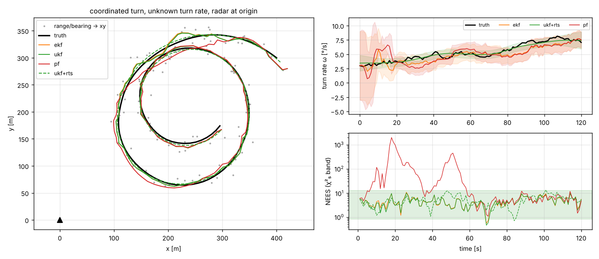

## Install and run

1. Clone the repository and install the requirements.

   ```bash
   git clone https://github.com/gaschenb/Estimation-Toolbox.git
   cd Estimation-Toolbox
   pip install -r requirements.txt
   pip install -e .
   ```

2. Open the GUI with `esttoolbox-gui` (or `python -m esttoolbox.gui`, and add `--dark` for the dark theme).
3. List the systems, problems and methods with `esttoolbox list`.
4. Rebuild every figure in this README with `python -m esttoolbox.examples.gallery docs/figures docs/benchmarks/benchmarks.json`, and the benchmark numbers with `python -m esttoolbox.examples.benchmark --out docs`.

It runs on Windows and Linux with Python 3.10 or newer. The dependencies are numpy, scipy and matplotlib, plus PyQt5 and pyqtgraph for the GUI.

## Features

1. Fourteen state-space systems x_k = f(x_{k−1}) + q, y_k = h(x_k) + r. Each one is a parametric family θ ↦ model, so the same object drives filtering, Monte Carlo studies and system identification.

   | name | model | why it is there |
   |---|---|---|
   | `cv-tracking` | 2-D white-noise-acceleration target, position measurements [1] | linear Gaussian: an exact reference for every method, and EM |
   | `pendulum` | α̇ = ω, ω̇ = −g sin α, y = sin α [2] | mild nonlinearity, parameter g |
   | `ct-radar` | coordinated turn with unknown turn rate, range/bearing radar [1] | nonlinear measurement with angle wrapping |
   | `ungm` | x_k = x/2 + 25x/(1+x²) + 8 cos 1.2k, y = x²/20 [3] | bimodal posterior, where Gaussian filters fail and PFs don't |
   | `lorenz63` | chaotic Lorenz-63, RK4 over Δt = 0.1 [4] | data assimilation with EnKF/ETKF |
   | `stochastic-volatility` | x_k = φx + ση, y = β e^{x/2} ε [5] | non-additive measurement, so PF and PMMH only |
   | `reactor` | 2A → B, y = p_A + p_B, poor prior [6] | the EKF converges to negative pressures and constrained MHE does not |
   | `bearings-only` | constant-velocity target, bearings from a manoeuvring ownship [7] | range is unobservable until the ownship turns |
   | `robot-landmarks` | unicycle with odometry, range and bearing to 5 landmarks [8] | EKF localization with many angle measurements |
   | `lorenz96` | Lorenz-96, 40 variables, F = 8, every other variable observed [9] | high-dimensional data assimilation, where the PF degenerates |
   | `vanderpol` | Van der Pol oscillator (μ = 2), position only | relaxation oscillation with a hidden velocity |
   | `predator-prey` | stochastic Lotka–Volterra on log-populations, Poisson counts | non-Gaussian count data for the PF and PMMH |
   | `battery-soc` | Thevenin 1-RC Li-ion cell, pulsed current, terminal voltage [10] | state of charge from a wrong initial guess, with SoC bounded in [0, 1] |
   | `reentry` | ballistic re-entry with unknown drag, surface radar [11] | stiff altitude-dependent drag, with the parameter learned as a state |

2. Fifteen static problems y = f(θ) + ε. The last three are general curves meant mostly for your own data. Nine of them accept your own inputs (marked "data").

   | name | model | parameters | data |
   |---|---|---|---|
   | `oscillator` | damped oscillator A e^{−ζω₀t} cos(ω_d t + φ) | A, ζ, ω₀, φ | t |
   | `heat` | diffusing Gaussian pulse at three times | α, Q, x₀ | |
   | `projectile` | projectile with quadratic drag, RK4 trajectory | v₀, angle, c | |
   | `reaction-diffusion` | Fisher–KPP front [12], spectral diffusion with exact logistic Strang splitting [13] | D, r | |
   | `optical-blur` | known scene convolved with a Gaussian PSF | σ_psf, gain | |
   | `acoustic` | point source A e^{−αr}/r on a 7×7 sensor grid | x₀, y₀, A, α | |
   | `enzyme-inhibition` | Michaelis–Menten with a competitive inhibitor [14] | V_max, K_m, K_i | S, I |
   | `pharmacokinetics` | oral one-compartment (Bateman) curve [15] | k_a, k_e, V | t |
   | `spectral-peaks` | two overlapping Lorentzian lines on a linear baseline | 8 | x |
   | `radial-velocity` | Keplerian orbit with a Newton solve of Kepler's equation | P, K, e, ω, M₀, γ | t |
   | `sir-epidemic` | SIR ODE, daily incidence [16] | β, γ, log₁₀ I₀ | day |
   | `theis-well` | Theis drawdown at observation wells [17] | log₁₀ T, log₁₀ S | t, r |
   | `exp-decay` | A e^{−kx} + c | A, k, c | x |
   | `logistic` | b + K/(1 + e^{−r(x−x₀)}) | K, r, x₀, b | x |
   | `gaussian-peak` | Gaussian peak on a linear baseline | a, μ, s, b₀, b₁ | x |

3. Fourteen state estimators: KF, square-root KF, EKF, iterated EKF, UKF, CKF, Gauss–Hermite KF, IPLF, EnKF, ETKF, bootstrap / regularized / optimal-proposal particle filters, and constrained MHE.
4. Smoothers: one generic Gaussian RTS that covers RTS, ERTS, URTS, cubature and ensemble RTS, an FFBSi particle smoother, and a full-horizon batch MAP trajectory.
5. Consistency checks: NEES and NIS with χ² bands for single runs and Monte Carlo averages, innovation whiteness, interval coverage, and R̂ and bulk/tail ESS for the samplers.
6. System identification: prediction-error ML/MAP on KF/EKF/UKF/CKF likelihoods, EM for linear-Gaussian models, and particle marginal Metropolis–Hastings.
7. Static estimators: least squares, MLE, MAP with the Laplace evidence, Fisher information and the Cramér–Rao bound, profile-likelihood intervals, residual / parametric / wild bootstrap, AIC/BIC, and four samplers (random-walk and adaptive Metropolis, an affine-invariant ensemble sampler, HMC), all multi-chain and vectorized across chains.
8. Your own data. Load a measurement file and the toolbox fits nearly-constant random-walk, velocity and acceleration models around it, in as many dimensions as the file has channels, with start values for the noise levels estimated from the data. Any built-in system with the same number of channels can be used too. Ground-truth columns are optional. With them you get errors and NEES, and without them the filters are judged by their innovations alone. Static data are fitted with any of the nine problems that take inputs, with per-point σ if the file has it.
9. A live GUI: sliders re-simulate and re-estimate while you drag, estimators run in parallel worker processes, plots share a time cursor, and there are light and dark themes.
10. A command line for single runs, Monte Carlo studies, system identification and static fits, on simulated data or a file.

## Methods

1. **Gaussian filters** (`core/gaussian.py`). They share one predict/update loop. Every predict also returns C_k = Cov(x_{k−1}, x_k | y_{1:k−1}), which lets a single RTS smoother serve all of them [18, 2].
   1. The KF uses the Joseph-form update [19, 1], and the square-root KF propagates Cholesky factors with QR array updates [20].
   2. The IEKF is Gauss–Newton on the measurement update, so it returns the MAP estimate [21].
   3. The UKF uses the scaled unscented transform with α, β and κ = max(3 − n, 0) [11, 22].
   4. The CKF uses the third-degree spherical-radial rule [23], and the GHKF a tensor Gauss–Hermite rule that is exact to degree 2p − 1 [24].
   5. The IPLF iterates sigma-point statistical linear regression of h around the current posterior [25].

   Angles are wrapped in every residual and in every sigma-point mean. The log-likelihood is the prediction-error decomposition Σ log N(v_k; 0, S_k) [2].
2. **Ensemble filters** (`core/ensemble.py`). The stochastic EnKF uses centred perturbed observations [26, 27]. The ETKF uses the symmetric square-root transform from a thin SVD in O(N·n_y²) [28]. Both support multiplicative inflation.
3. **Particle filters** (`core/particle.py`). The bootstrap filter [29] resamples when the ESS drops. The regularized PF adds Gaussian kernel jitter with the optimal bandwidth after resampling [30]. The third PF uses the locally linearized optimal proposal, batched over particles [31]. Resampling can be multinomial, stratified, systematic or residual [32]. The likelihood is the standard unbiased SMC estimate.
4. **Smoothers** (`core/smoothers.py`). The Gaussian RTS also returns the lag-one cross-covariances P^s_{k+1,k} = P^s_{k+1} G_kᵀ that EM needs [18, 33]. FFBSi is vectorized as an M × N backward kernel [34].
5. **MHE** (`core/mhe.py`). The window problem over x_s … x_k has an arrival cost, process and measurement residuals and box constraints [35]. I solve it with projected Levenberg–Marquardt on the sparse block-banded normal equations, with analytic block Jacobians. The arrival cost moves forward by one EKF step linearized at the MHE estimate, which avoids counting window data twice. With this arrival cost the linear MHE reproduces the KF exactly for any horizon. `batch_map` solves the full-horizon problem and returns the MAP trajectory with Gauss–Newton marginal covariances.
6. **Consistency** (`core/consistency.py`). NEES_k = e_kᵀP_k⁻¹e_k should follow χ²(n_x) and NIS_k = v_kᵀS_k⁻¹v_k should follow χ²(n_y). For R-run averages the acceptance band is χ²_{R·n}(α/2, 1 − α/2)/R, and time averages work the same way [1]. Whiteness is checked with the autocorrelation of the whitened innovations (bounds ±1.96/√(T n_y)) and Ljung–Box p-values [36]. With your own data the NEES uses only the states the file has truth for.
7. **System identification** (`core/sysid.py`). Parameters are mapped to an unconstrained u with θ = lo + (hi − lo)·sigmoid(u).
   1. PEM maximizes the filter likelihood, optionally with a Gaussian prior on u, using BFGS [37]. Standard errors come from the numerical Hessian in u, mapped back by the delta method.
   2. EM (Shumway–Stoffer) estimates any of A, C, Q, R, m₀ and P₀ [33]. Q and R can be full, diagonal or scaled, so that the structure is kept, for example Q = q·Q₁. The log-likelihood never decreases.
   3. PMMH is pseudo-marginal Metropolis–Hastings on u with a bootstrap-PF likelihood [38]. Its adaptive proposal is frozen after burn-in.
8. **Static estimators** (`core/paramest.py`).
   1. Least squares uses a bounded trust-region solver with multiple starts. The central-difference Jacobian is one batched call.
   2. MLE estimates σ jointly and reports AIC and BIC. MAP adds the Laplace approximation and its log evidence, which is exact for linear models.
   3. The Fisher information gives the Cramér–Rao bound, its eigenvalues, condition number and correlations.
   4. Profile-likelihood intervals use Wilks' theorem with root bracketing on each side [39].
   5. The bootstrap can be residual, parametric or wild [40, 41].
   6. The samplers are random-walk Metropolis with the 2.38²/d scaling [42], adaptive Metropolis [43], the affine-invariant ensemble sampler [44], and HMC [45] with dual-averaging step sizes [46] and a Laplace mass matrix. All of them run several chains and report rank-normalized split-R̂ and bulk/tail ESS [47].
9. **Your own data** (`core/userdata.py`).
   1. Files can be .csv, .tsv, .txt, .npy or .npz. The delimiter and header are detected.
   2. In a time series, a column named `t` or `time` holds the sample times, columns named `x_<state>` hold ground truth, and every other column is a measurement. Rows are sorted by time, and rows with missing measurements are dropped, with a note in the GUI.
   3. The kinematic models are the white-noise random walk, velocity and acceleration models [1], discretized with Van Loan's method [48]. Their start values come from the variance of the n-th differences of the data, which is split between measurement noise and process noise.
   4. Static files hold the input column(s), then y, then an optional σ. With per-point σ the residuals are whitened. Without it, σ starts from the scatter of neighbouring points, and you can set it yourself.
10. **Speed.** The GUI sends every estimator to a pool of worker processes, one task per method. A newer request supersedes an older one, and stale results are never shown. Monte Carlo runs are split across the workers and merged, and the merged result is identical to the serial run.

## Results/Examples

1. **Monte Carlo comparison of the state estimators** on seven of the systems, with 50 runs each (16 for the reactor). RMSE is over all states and steps. ANEES is the median over time of the run-averaged NEES, shown with its 95 % band, and "in band" is the fraction of time steps inside the band.

   | system | method | RMSE | ANEES (band) | in band | ms/run |
   |---|---|---|---|---|---|
   | cv-tracking | KF / SRKF / UKF | 1.100 | 3.83 [3.25, 4.82] | 91 % | 5.5 / 6.4 / 8.3 |
   | | KF + RTS | 0.648 | 3.93 | 97 % | 8.9 |
   | pendulum | EKF / UKF / PF | 0.174 / 0.172 / 0.174 | 2.02 / 1.86 / 1.92 [1.48, 2.59] | 72–74 % | 35 / 44 / 113 |
   | | UKF + URTS | 0.100 | 2.04 | 96 % | 60 |
   | ct-radar | EKF / UKF / CKF / ETKF | 6.74 | 4.6–4.8 [4.16, 5.91] | 90 % | 19–31 |
   | | UKF + URTS | 3.45 | 4.82 | 88 % | 24 |
   | | bootstrap PF / regularized PF (N = 1000) | 28.3 / 7.13 | 5.6·10³ / 3.59 | 1 % / 6 % | 63 / 78 |
   | ungm | EKF / UKF / CKF | 22.3 / 9.53 / 13.7 | 176 / 5.6 / 98 [0.65, 1.43] | 0 % | 6–7 |
   | | EnKF / PF | 5.38 / 4.69 | 1.01 / 1.02 | 83 % / 90 % | 15 / 20 |
   | | PF + FFBSi | 1.64 | 1.02 | 86 % | 245 |
   | lorenz63 | EKF / UKF / ETKF / PF | 1.46 / 1.40 / 1.42 / 1.38 | 3.5 / 3.0 / 3.1 / 3.1 [2.36, 3.72] | 62 / 94 / 92 / 92 % | 78 / 47 / 68 / 131 |
   | stochastic-volatility | PF / PF + FFBSi | 1.10 / 0.93 | 0.96 / 1.03 [0.65, 1.43] | 96 % / 94 % | 18 / 490 |
   | reactor | EKF / UKF | 3.76 / all runs diverged | 4.8·10³ | 1 % | 45 |
   | | constrained MHE (N = 15) / CKF | 0.76 / 0.99 | 42 / 7.0 [1.14, 3.09] | 1 % / 27 % | 1342 / 27 |
   | | regularized PF / + FFBSi | 0.167 / 0.032 | 1.7 / 2.0 | 89 % / 96 % | 57 / 1018 |

   1. On the linear model every Gaussian filter matches the KF to machine precision and is consistent, and the smoother halves the RMSE.
   2. On UNGM the posterior is bimodal. The EKF and CKF are inconsistent by two orders of magnitude, the UKF is less wrong, and the PF is both accurate and consistent. FFBSi resolves the sign ambiguity and brings the RMSE from 4.7 to 1.6 [3, 34].
   3. On ct-radar the Gaussian filters are consistent and equivalent. A 1000-particle bootstrap PF impoverishes in the nearly deterministic turn rate (process noise 0.2°/s) and loses the track. Kernel regularization fixes most of that [30].
   4. On the reactor the EKF settles on negative pressures, and the UKF's sigma points land where the ODE blows up [6]. Constrained MHE converges, with errors below 0.01 after about 40 steps with N = 15. Its Gauss–Newton covariance ignores active constraints, though, so its NEES means little early on. The regularized PF is accurate and consistent.
   5. FFBSi inherits the particle filter's support. Where the filter's particles collapse in a nearly deterministic state, FFBSi's sample covariance is degenerate (huge NEES) even when its mean is good.

   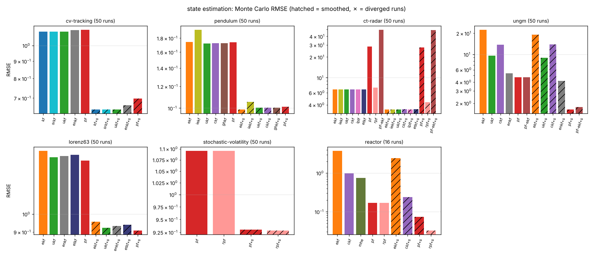

   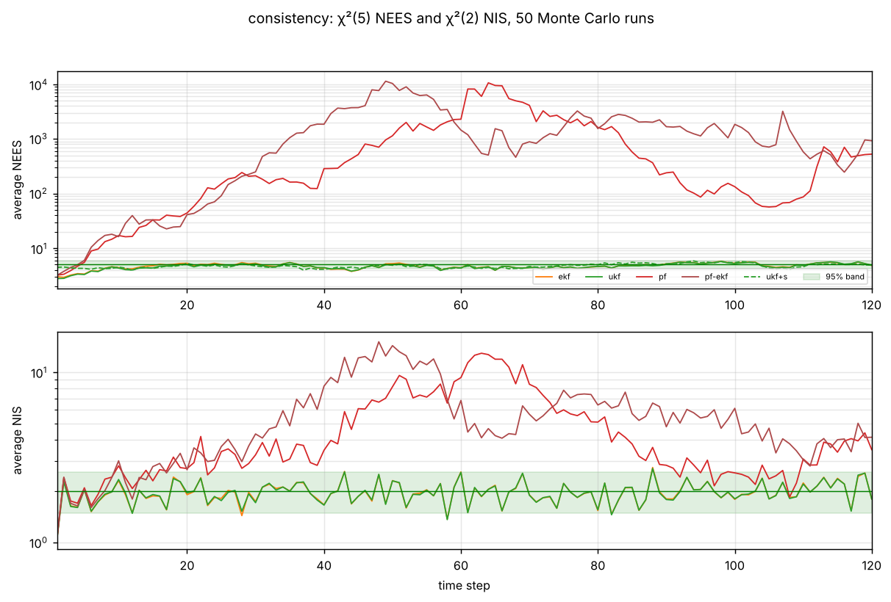

   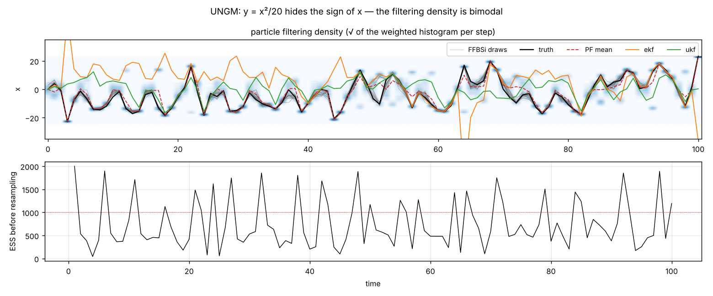

   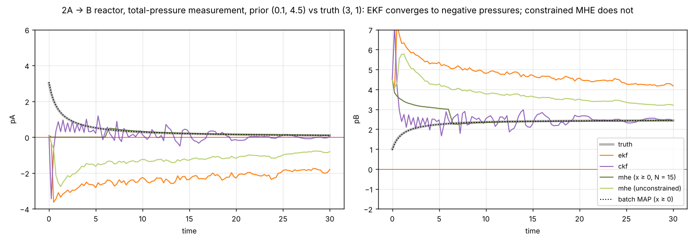

   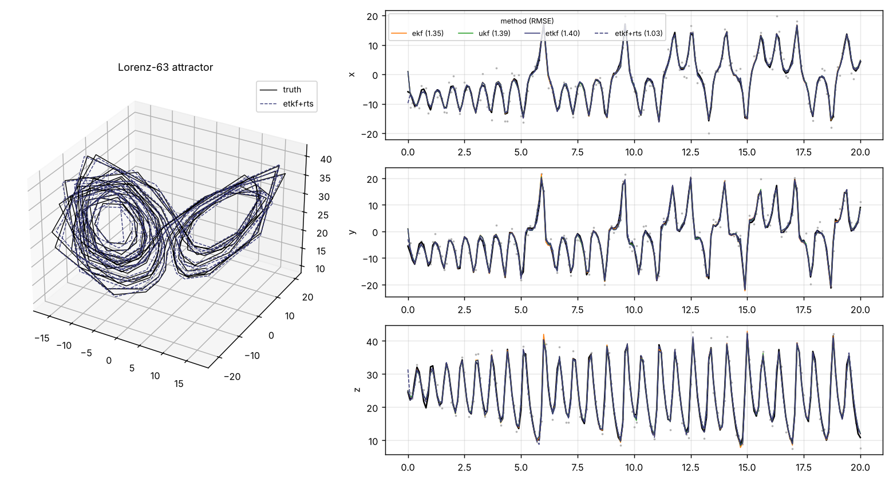

2. **More systems.** These are six of the systems from the table above, each with the filter that suits it.

   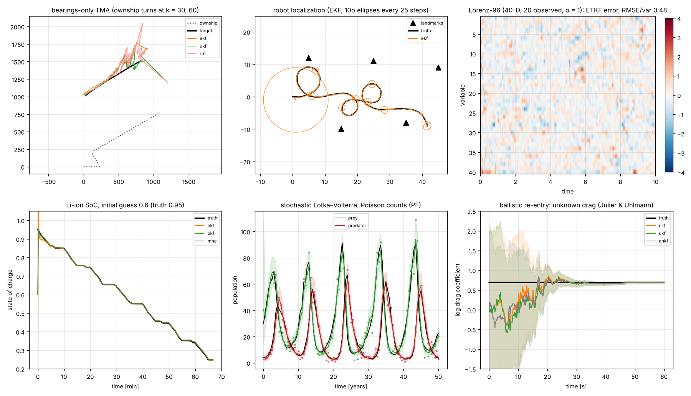

3. **System identification.** EM and PEM reach the same optimum of the KF likelihood on `cv-tracking`. EM increases the likelihood at every step and converges in under 100 iterations. PMMH on stochastic volatility (T = 500, 300 particles, acceptance 0.20) gives a posterior ESS of 130–160 per parameter from 4500 post-burn-in draws [38].

   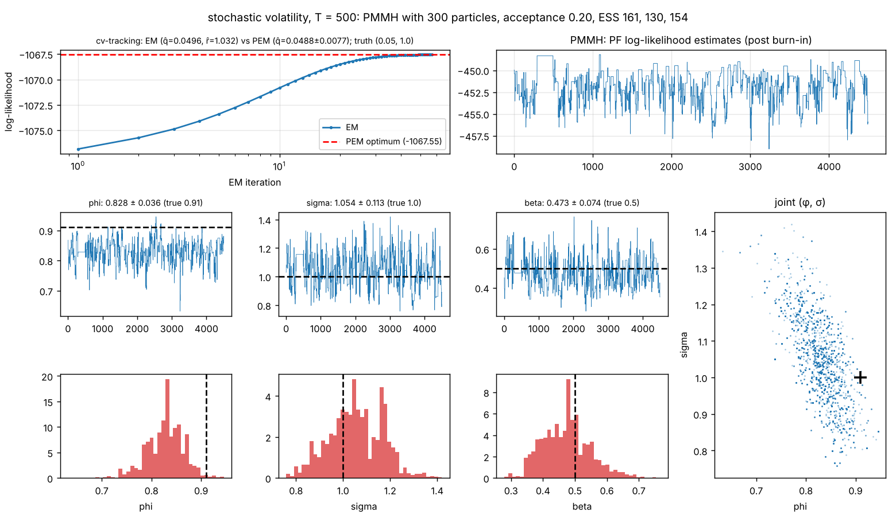

4. **Static problems.** Timings are on one core.

   | problem | LS ms | forward µs (single θ / per θ in a batch of 16) | MCMC min ESS/s (AM / HMC) | bootstrap ×100 s |
   |---|---|---|---|---|
   | oscillator | 4.3 | 15 / 2.8 | 1 897 / 7 821 | 0.15 |
   | heat | 3.0 | 20 / 1.2 | 3 395 / 25 250 | 0.14 |
   | projectile | 20.8 | 41 / 75 | 165 / 1 019 | 0.75 |
   | reaction-diffusion | 10.1 | 428 / 124 | 326 / 897 | 0.96 |
   | optical-blur | 1.6 | 13 / 1.8 | 3 613 / 27 842 | 0.19 |
   | acoustic | 2.4 | 12 / 1.3 | 2 076 / 12 559 | 0.11 |

   HMC gets 3–8× more effective samples per second than adaptive Metropolis. Batching θ cuts the per-θ forward cost by 3–17×. The projectile is the exception, because it already has a scalar fast path. All ESS values come from the same multi-chain estimator [47]. Over 40 simulated data sets, the nominal 90 % intervals from least squares, the profile likelihood and HMC all cover close to 90 %. These problems are well identified, and the profile interval does not rely on the local Gaussian approximation [39].

   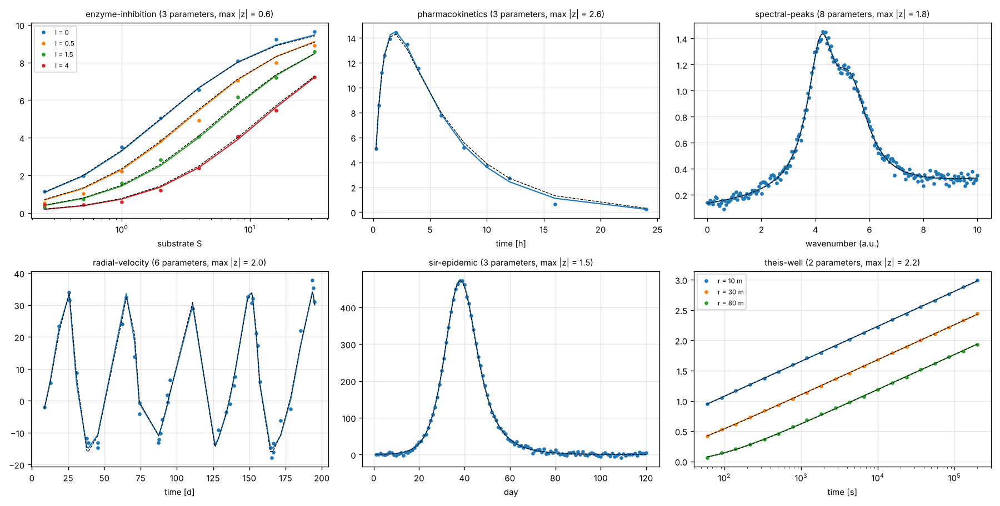

   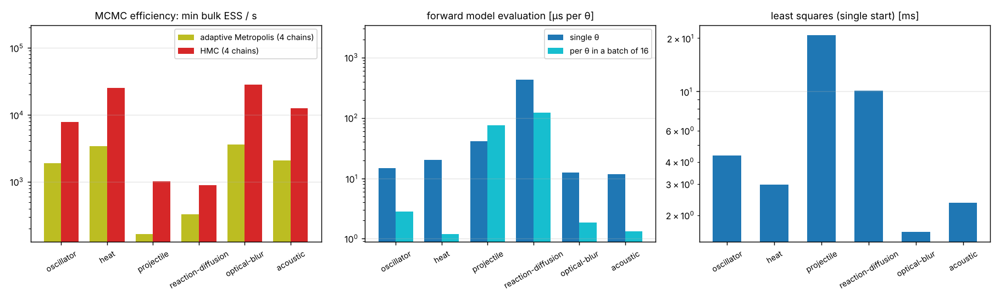

   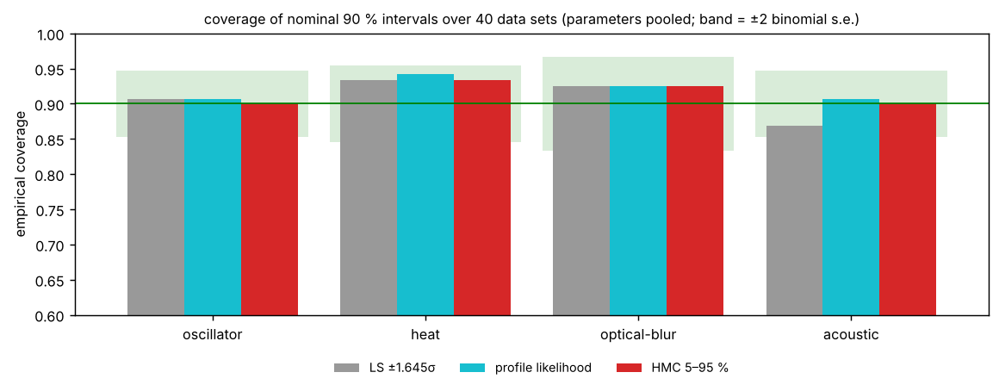

   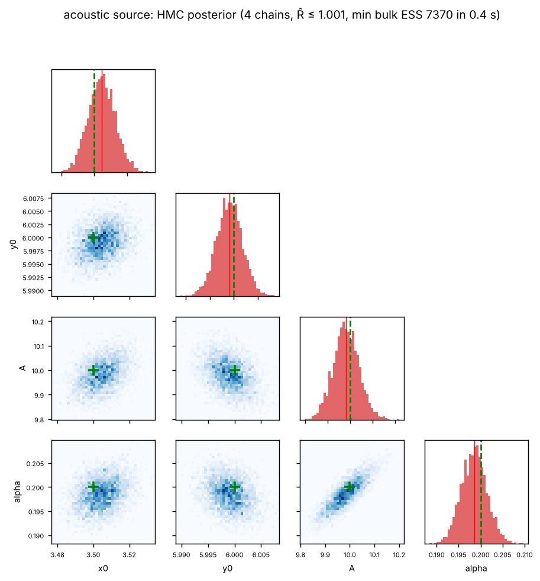

   The raw numbers are in [docs/benchmarks/benchmarks.json](docs/benchmarks/benchmarks.json).

5. **Your own data.** `esttoolbox/examples/data` has two example files: a manoeuvring target (`track.csv`, with truth for the positions) and a cooling curve with per-point σ (`cooling.csv`). On the track, a constant-velocity KF with the start values guessed from the file reaches an RMSE of 3.7 against 3.0 measurement noise, and the NEES flags it as overconfident in the turns. After EM estimates q and r from the same file [33], the KF's RMSE drops to 2.1 and its NEES moves to the conservative side of the band. The RTS smoother helps further. On the cooling curve, least squares, the profile likelihood and HMC all give k = 0.0451, against the 0.045 used to make the file.

## GUI

1. There are three workspaces in the sidebar: state estimation, system identification and static parameters. Each has a control column, plot views and a results table.
2. At the top of each workspace you choose the data: Simulated, or My data with Load file….
   1. In state estimation and system identification, the System list then offers the kinematic models and every built-in system that matches the file's channels. The sliders tune the filters' model on your data instead of re-simulating it.
   2. Without truth columns the Errors view and the NEES panel tell you why they are empty, and the table judges each filter by its NIS band.
   3. In the static workspace, only problems that take inputs are enabled, and the sliders become starting values.
3. Every model parameter has a slider, log-scaled for scale parameters. Moving it, or changing the horizon, seed, methods or tuning, re-runs the estimators while you drag. Methods that take longer than 0.6 s (MHE on Lorenz-96, for example) are not re-run automatically. They show "press Run" (Ctrl+R) in the table.
4. The States, Errors, Consistency and Particles views share a time cursor. Click or drag it, or use ←/→ (Shift steps by 10). The header reads out the truth and the estimates ± 2σ at the cursor. The Track view draws each method's 2σ ellipse and particle cloud at that step. The Particles view shows the filtering density over time next to the density slice at the cursor, with the Gaussian filters' marginals overlaid.
5. Mouse wheel and drag zoom and pan. Zooming out stops at the full extent of the data. Click a legend entry to hide a curve, double-click a results row to show only that method, and right-click for axis options and export.
6. State estimation has the 14 systems, 14 estimators, RTS/FFBSi smoothers and batch MAP. Its views are States, Track, Errors, Consistency (NEES/NIS with χ² regions), Innovations (whitened sequence and autocorrelation), Particles, Measurements and Monte Carlo (run-averaged NEES, with RMSE, ANEES and runtime bars).
7. System identification runs PEM, EM and PMMH with a choice of free parameters. Its views are Data, Convergence (with PMMH traces), Posterior and Likelihood slices.
8. In the static workspace, least squares, MLE, MAP and Fisher update live, and the profile likelihood, the bootstrap and the four samplers run on Run. Its views are Fit, Posterior (corner plot), Traces, Profile likelihood and Compare. The table has z-scores (on simulated data), R̂ and ESS.
9. Ctrl+T switches between light and dark themes. Ctrl+E exports the current plot (PNG), Ctrl+Shift+E exports the table (CSV), and Esc cancels.
10. The GUI responds quickly. Measured offscreen on a 4-core machine with 3 worker processes, the first estimate is on screen 40–130 ms after a slider change, and all live estimators finish in 140–400 ms (the most is Lorenz-96 at 40 dimensions). Monte Carlo on the pendulum with 60 runs takes 8.9 s serially and 3.1 s on 3 workers.

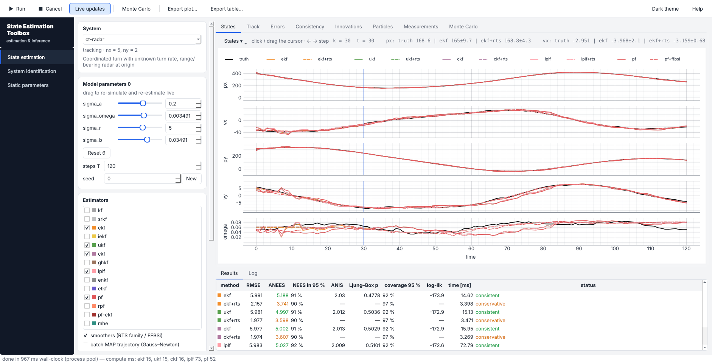

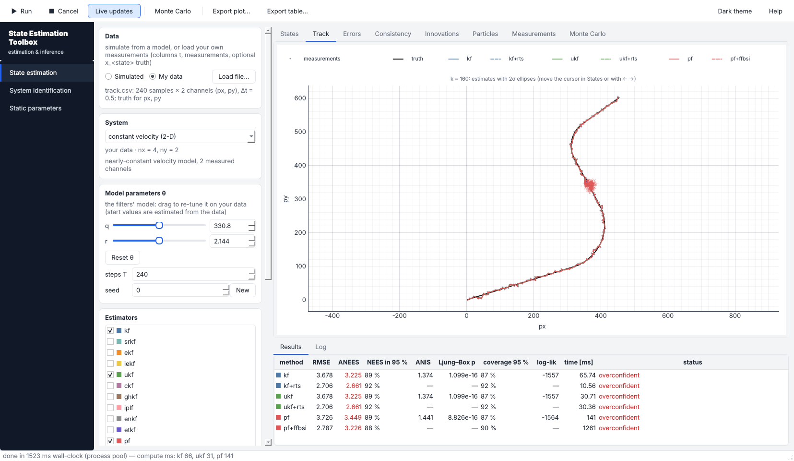

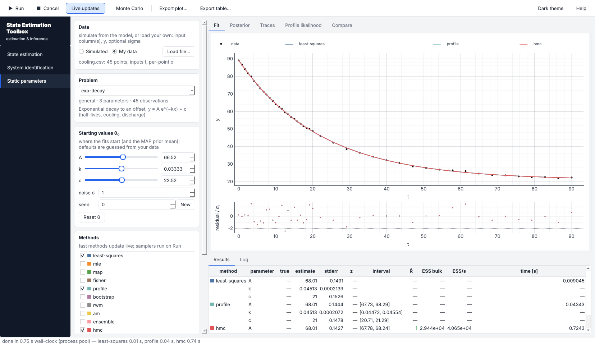

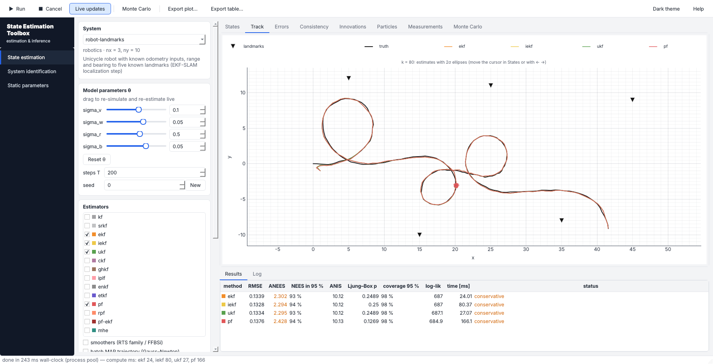

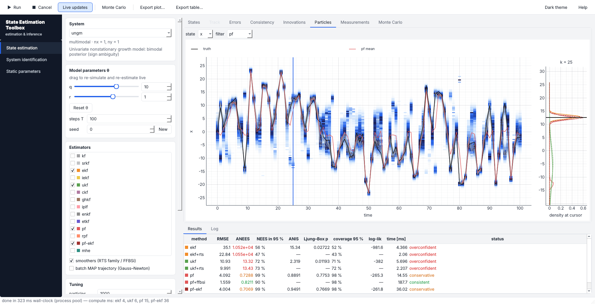

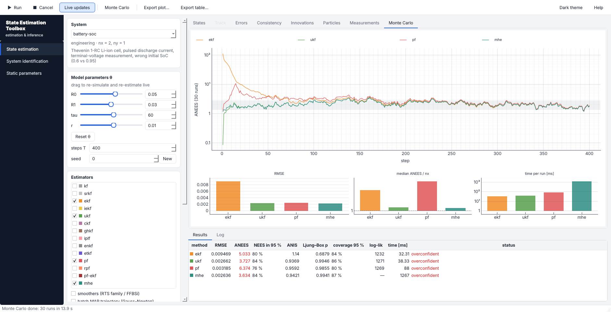

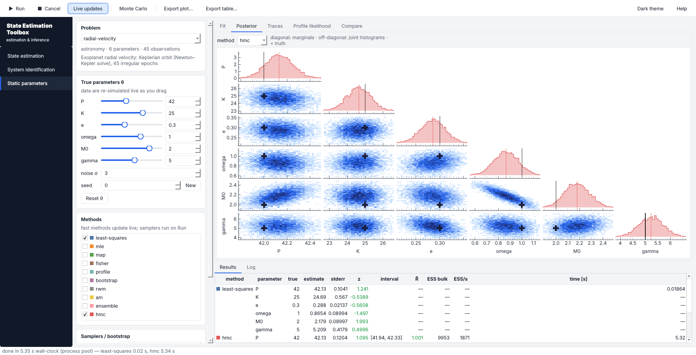

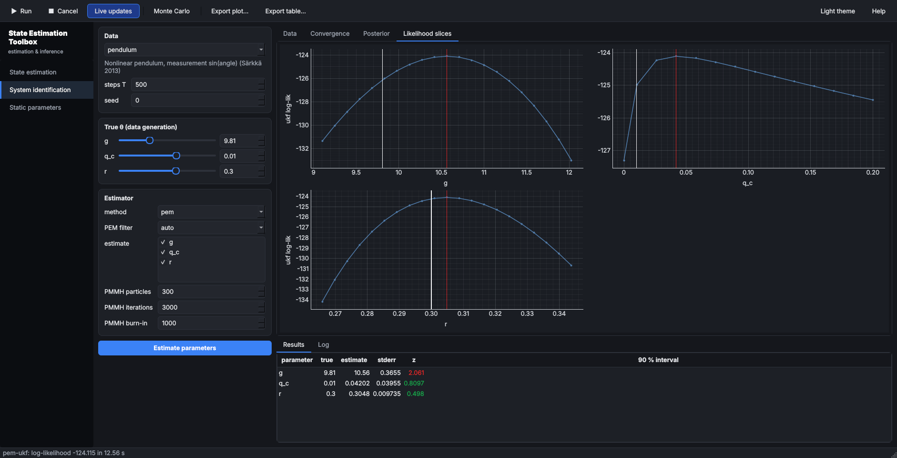

## CLI

1. List everything with `esttoolbox list`.
2. Run estimators once on a simulated system:

   ```bash
   esttoolbox filter --system ungm --methods ekf,ukf,pf,pf-ekf --smooth --seed 1
   esttoolbox filter --system reactor --methods ekf,ckf,mhe,rpf,batch-map --horizon 15
   ```

   `filter` prints RMSE, ANEES with its band, the % of steps in the band, ANIS, the smallest Ljung–Box p-value, the log-likelihood and the runtime. It writes the states, consistency, track and particle plots and `results.json` to `--out` (default `est_output/`).
3. Run a Monte Carlo study with `esttoolbox mc --system ct-radar --methods ekf,ukf,ckf,rpf --runs 50 --smooth`.
4. Identify parameters:

   ```bash
   esttoolbox sysid --system cv-tracking --method em
   esttoolbox sysid --system pendulum --method pem --filter ekf --free g,r
   esttoolbox sysid --system stochastic-volatility --method pmmh --n-iter 4000 --n-particles 300
   ```

5. Fit a static problem with `esttoolbox static --system reaction-diffusion --method least-squares,profile,hmc`.
6. Add `--data <file>` to `filter`, `sysid` or `static` to use your own measurements. For time series, `--system` can be `rw`, `cv` (the default) or `ca`, or any built-in system with the same number of channels. For static data, `--noise` sets σ when the file has no σ column.

   ```bash
   esttoolbox filter --data esttoolbox/examples/data/track.csv --system cv --methods kf,ukf,pf --smooth
   esttoolbox sysid  --data esttoolbox/examples/data/track.csv --method em
   esttoolbox static --data esttoolbox/examples/data/cooling.csv --system exp-decay --method least-squares,profile,hmc
   ```

## Library use

1. Simulate a system, filter, smooth and check consistency:

   ```python
   from esttoolbox import get_ssm, run_method, smooth, monte_carlo, consistency

   p = get_ssm("ct-radar")
   model = p.model()                          # or p.model(theta)
   xs, ys = model.simulate(p.T, rng=0)
   ukf = run_method("ukf", model, ys)
   urts = smooth(ukf, model)
   print(consistency.report(xs, ukf))         # RMSE, ANEES + band, ANIS, Ljung–Box, coverage

   mc = monte_carlo(p, ["ekf", "ukf", "rpf"], n_runs=50, smoother=True)
   print(mc["_summary"]["ukf"])
   ```

2. Filter your own measurements and estimate the noise levels:

   ```python
   from esttoolbox import load_series, kinematic_problem, full_truth, run_method, sysid, consistency

   data = load_series("track.csv")            # columns t, px, py[, x_px, x_py]
   p = kinematic_problem(data, "cv")           # or "rw", "ca"; start values from the data
   fit = sysid.em(p, data.ys)                  # or sysid.pem(p, data.ys, "kf")
   model = p.model(fit.theta_hat)
   kf = run_method("kf", model, data.ys)
   print(consistency.report(full_truth(data, model), kf))
   ```

3. Fit a curve to your own data:

   ```python
   from esttoolbox import get_static, load_static, STATIC_METHODS

   p = get_static("exp-decay")
   prob, y, sigma = p.with_data(load_static("cooling.csv", p.inputs))
   r = STATIC_METHODS["profile"](prob, y, sigma)
   print(r.theta_hat, r.ci)
   ```

4. A custom model is a `StateSpaceModel(name, nx, ny, f, h, Q, R, m0, P0, F_jac=..., H_jac=...)` with f and h vectorized over leading axes. Jacobians default to batched central differences.

## Layout

```
esttoolbox/
├── cli.py, __main__.py
├── core/
│   ├── linalg.py        Cholesky with jitter, QR triangularization, Van Loan, batched FD Jacobians
│   ├── ssm.py           StateSpaceModel, LinearGaussianSSM
│   ├── systems.py       the 14 state-space systems (parametric families)
│   ├── gaussian.py      KF, SRKF, EKF, IEKF, UKF, CKF, GHKF, IPLF
│   ├── ensemble.py      EnKF, ETKF
│   ├── particle.py      bootstrap / regularized / optimal-proposal PF, resampling
│   ├── smoothers.py     Gaussian RTS, FFBSi
│   ├── mhe.py           MHE and batch MAP (sparse projected Levenberg–Marquardt)
│   ├── consistency.py   NEES, NIS, χ² bands, whiteness, coverage
│   ├── run.py           method registry, smoothing, Monte Carlo
│   ├── sysid.py         PEM, EM, PMMH
│   ├── static.py        the 15 static problems (batched forward models)
│   ├── paramest.py      static estimators and samplers
│   ├── mcmc.py          RWM, AM, ensemble, HMC
│   ├── diagnostics.py   R̂, bulk/tail ESS
│   ├── userdata.py      reading your files, kinematic models built around them
│   └── plots.py         figures shared by the CLI and the gallery
├── gui/
│   ├── app.py           main window: sidebar, toolbar, themes, shortcuts
│   ├── state_page.py    state estimation workspace (live, time cursor, Monte Carlo)
│   ├── sysid_page.py    system identification workspace
│   ├── static_page.py   static parameter workspace
│   ├── compute.py       process-pool back end (generation-tagged tasks, cancel)
│   ├── widgets.py       sliders, data source, method list, results table, plot helpers
│   └── theme.py         light / dark palettes and style sheet
└── examples/            gallery.py, benchmark.py, data/ (track.csv, cooling.csv)
```

## Citations

1. Y. Bar-Shalom, X. R. Li and T. Kirubarajan, *Estimation with Applications to Tracking and Navigation*. Wiley, 2001.
2. S. Särkkä, *Bayesian Filtering and Smoothing*. Cambridge University Press, 2013.
3. G. Kitagawa, "Monte Carlo filter and smoother for non-Gaussian nonlinear state space models," *J. Comput. Graph. Stat.*, 5(1):1–25, 1996.
4. E. N. Lorenz, "Deterministic nonperiodic flow," *J. Atmos. Sci.*, 20(2):130–141, 1963.
5. S. Kim, N. Shephard and S. Chib, "Stochastic volatility: likelihood inference and comparison with ARCH models," *Rev. Econ. Stud.*, 65(3):361–393, 1998.
6. E. L. Haseltine and J. B. Rawlings, "Critical evaluation of extended Kalman filtering and moving-horizon estimation," *Ind. Eng. Chem. Res.*, 44(8):2451–2460, 2005.
7. S. C. Nardone, A. G. Lindgren and K. F. Gong, "Fundamental properties and performance of conventional bearings-only target motion analysis," *IEEE Trans. Autom. Control*, 29(9):775–787, 1984.
8. S. Thrun, W. Burgard and D. Fox, *Probabilistic Robotics*. MIT Press, 2005.
9. E. N. Lorenz, "Predictability: a problem partly solved," in *Proc. ECMWF Seminar on Predictability*, vol. 1, 1996, pp. 1–18.
10. G. L. Plett, "Extended Kalman filtering for battery management systems of LiPB-based HEV battery packs. Part 3: State and parameter estimation," *J. Power Sources*, 134(2):277–292, 2004.
11. S. J. Julier and J. K. Uhlmann, "Unscented filtering and nonlinear estimation," *Proc. IEEE*, 92(3):401–422, 2004.
12. R. A. Fisher, "The wave of advance of advantageous genes," *Ann. Eugen.*, 7(4):355–369, 1937.
13. G. Strang, "On the construction and comparison of difference schemes," *SIAM J. Numer. Anal.*, 5(3):506–517, 1968.
14. L. Michaelis and M. L. Menten, "Die Kinetik der Invertinwirkung," *Biochem. Z.*, 49:333–369, 1913.
15. M. Gibaldi and D. Perrier, *Pharmacokinetics*, 2nd ed. Marcel Dekker, 1982.
16. W. O. Kermack and A. G. McKendrick, "A contribution to the mathematical theory of epidemics," *Proc. R. Soc. A*, 115(772):700–721, 1927.
17. C. V. Theis, "The relation between the lowering of the piezometric surface and the rate and duration of discharge of a well using ground-water storage," *Trans. Am. Geophys. Union*, 16(2):519–524, 1935.
18. H. E. Rauch, F. Tung and C. T. Striebel, "Maximum likelihood estimates of linear dynamic systems," *AIAA J.*, 3(8):1445–1450, 1965.
19. R. E. Kalman, "A new approach to linear filtering and prediction problems," *J. Basic Eng.*, 82(1):35–45, 1960.
20. G. J. Bierman, *Factorization Methods for Discrete Sequential Estimation*. Academic Press, 1977.
21. B. M. Bell and F. W. Cathey, "The iterated Kalman filter update as a Gauss–Newton method," *IEEE Trans. Autom. Control*, 38(2):294–297, 1993.
22. E. A. Wan and R. van der Merwe, "The unscented Kalman filter for nonlinear estimation," in *Proc. IEEE Adaptive Systems for Signal Processing, Communications, and Control Symposium*, 2000, pp. 153–158.
23. I. Arasaratnam and S. Haykin, "Cubature Kalman filters," *IEEE Trans. Autom. Control*, 54(6):1254–1269, 2009.
24. K. Ito and K. Xiong, "Gaussian filters for nonlinear filtering problems," *IEEE Trans. Autom. Control*, 45(5):910–927, 2000.
25. Á. F. García-Fernández, L. Svensson, M. R. Morelande and S. Särkkä, "Posterior linearization filter: principles and implementation using sigma points," *IEEE Trans. Signal Process.*, 63(20):5561–5573, 2015.
26. G. Evensen, "Sequential data assimilation with a nonlinear quasi-geostrophic model using Monte Carlo methods to forecast error statistics," *J. Geophys. Res.*, 99(C5):10143–10162, 1994.
27. G. Burgers, P. J. van Leeuwen and G. Evensen, "Analysis scheme in the ensemble Kalman filter," *Mon. Weather Rev.*, 126(6):1719–1724, 1998.
28. C. H. Bishop, B. J. Etherton and S. J. Majumdar, "Adaptive sampling with the ensemble transform Kalman filter. Part I: Theoretical aspects," *Mon. Weather Rev.*, 129(3):420–436, 2001.
29. N. J. Gordon, D. J. Salmond and A. F. M. Smith, "Novel approach to nonlinear/non-Gaussian Bayesian state estimation," *IEE Proc. F*, 140(2):107–113, 1993.
30. C. Musso, N. Oudjane and F. Le Gland, "Improving regularised particle filters," in *Sequential Monte Carlo Methods in Practice*, A. Doucet, N. de Freitas and N. Gordon, Eds. Springer, 2001, pp. 247–271.
31. A. Doucet, S. Godsill and C. Andrieu, "On sequential Monte Carlo sampling methods for Bayesian filtering," *Stat. Comput.*, 10(3):197–208, 2000.
32. R. Douc, O. Cappé and E. Moulines, "Comparison of resampling schemes for particle filtering," in *Proc. 4th Int. Symp. Image and Signal Processing and Analysis*, 2005, pp. 64–69.
33. R. H. Shumway and D. S. Stoffer, "An approach to time series smoothing and forecasting using the EM algorithm," *J. Time Ser. Anal.*, 3(4):253–264, 1982.
34. S. J. Godsill, A. Doucet and M. West, "Monte Carlo smoothing for nonlinear time series," *J. Am. Stat. Assoc.*, 99(465):156–168, 2004.
35. C. V. Rao, J. B. Rawlings and D. Q. Mayne, "Constrained state estimation for nonlinear discrete-time systems: stability and moving horizon approximations," *IEEE Trans. Autom. Control*, 48(2):246–258, 2003.
36. G. M. Ljung and G. E. P. Box, "On a measure of lack of fit in time series models," *Biometrika*, 65(2):297–303, 1978.
37. L. Ljung, *System Identification: Theory for the User*, 2nd ed. Prentice Hall, 1999.
38. C. Andrieu, A. Doucet and R. Holenstein, "Particle Markov chain Monte Carlo methods," *J. R. Stat. Soc. B*, 72(3):269–342, 2010.
39. D. J. Venzon and S. H. Moolgavkar, "A method for computing profile-likelihood-based confidence intervals," *Appl. Stat.*, 37(1):87–94, 1988.
40. B. Efron and R. J. Tibshirani, *An Introduction to the Bootstrap*. Chapman & Hall, 1993.
41. C. F. J. Wu, "Jackknife, bootstrap and other resampling methods in regression analysis," *Ann. Stat.*, 14(4):1261–1295, 1986.
42. G. O. Roberts, A. Gelman and W. R. Gilks, "Weak convergence and optimal scaling of random walk Metropolis algorithms," *Ann. Appl. Probab.*, 7(1):110–120, 1997.
43. H. Haario, E. Saksman and J. Tamminen, "An adaptive Metropolis algorithm," *Bernoulli*, 7(2):223–242, 2001.
44. J. Goodman and J. Weare, "Ensemble samplers with affine invariance," *Commun. Appl. Math. Comput. Sci.*, 5(1):65–80, 2010.
45. R. M. Neal, "MCMC using Hamiltonian dynamics," in *Handbook of Markov Chain Monte Carlo*, S. Brooks, A. Gelman, G. Jones and X.-L. Meng, Eds. CRC Press, 2011, pp. 113–162.
46. M. D. Hoffman and A. Gelman, "The No-U-Turn sampler: adaptively setting path lengths in Hamiltonian Monte Carlo," *J. Mach. Learn. Res.*, 15:1593–1623, 2014.
47. A. Vehtari, A. Gelman, D. Simpson, B. Carpenter and P.-C. Bürkner, "Rank-normalization, folding, and localization: an improved R̂ for assessing convergence of MCMC," *Bayesian Anal.*, 16(2):667–718, 2021.
48. C. F. Van Loan, "Computing integrals involving the matrix exponential," *IEEE Trans. Autom. Control*, 23(3):395–404, 1978.
